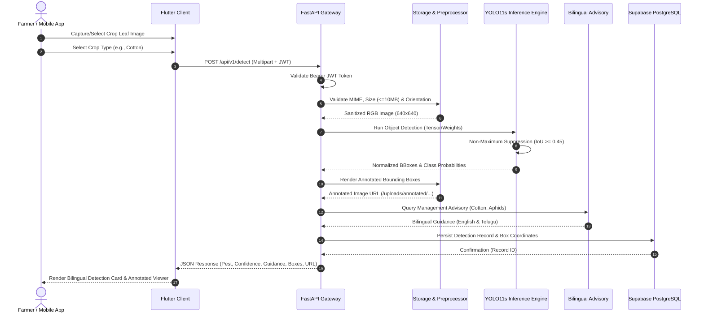

# CropGuard AI — System Architecture & Technical Design

**Project:** CropGuard AI — Intelligent Pest Detection & Crop Protection  
**Domain:** Artificial Intelligence, Computer Vision, Precision Agriculture, Cross-Platform Mobile Engineering  
**Academic Level:** B.Tech Computer Science & Engineering Capstone Project  

---

## 1. System Overview

CropGuard AI is a production-minded cross-platform mobile agricultural intelligence solution designed specifically for Indian farmers and agricultural practitioners. The system empowers smallholder and commercial farmers cultivating **Paddy/Rice, Cotton, Tomato, and Chilli** to detect and identify harmful insect pests through smartphone camera imagery, receive localized bilingual (English & Telugu) agricultural guidance, and track infestation trends over time.

The architecture comprises three primary tiers:
1. **Cross-Platform Mobile Client (Flutter / Dart):** Material 3 UI, camera/gallery capture, offline-first bilingual caching, JWT session management.
2. **High-Performance Inference Backend (FastAPI / Python):** RESTful endpoints, image preprocessing, multi-crop object detection, bounding-box rendering, and advisory resolution.
3. **Managed Cloud Infrastructure (Supabase PostgreSQL & GoTrue):** User identity authentication, encrypted storage, and PostgreSQL database with Row Level Security (RLS).

---

## 2. High-Level Architecture Diagram

```mermaid
flowchart TD
    subgraph Mobile_Tier["Mobile Client Tier (Flutter)"]
        UI["Material 3 UI Screens<br/>(Splash, Auth, Home, Scan, Result, History, Profile)"]
        Prov["State Providers<br/>(AuthProvider, AppStrings Telugu/English)"]
        Cam["Device Camera / Gallery Picker"]
        NetClient["HTTP / Dio Network Client"]
        SupaFlutter["Supabase Flutter SDK (Auth & Session)"]
    end

    subgraph Backend_Tier["Inference Backend Tier (FastAPI)"]
        API["FastAPI Gateway (Uvicorn / ASGI)"]
        AuthMid["JWT Auth Middleware & Security Validator"]
        StorageSvc["Storage & Image Preprocessing (Pillow / EXIF)"]
        Detector["YOLO11s Inference Engine (PyTorch / Ultralytics)"]
        AdvisorySvc["Bilingual Advisory Service (EN & TE)"]
        HistorySvc["Scan History & Persistence Service"]
    end

    subgraph Data_Tier["Cloud Database & Storage (Supabase)"]
        Postgres[("Supabase PostgreSQL DB<br/>RLS Enabled")]
        GoTrue["GoTrue Authentication Service"]
        StorageBucket["Supabase Storage Bucket (Pest Imagery)"]
    end

    UI --> Prov
    Cam --> UI
    UI --> NetClient
    UI --> SupaFlutter
    SupaFlutter <--> GoTrue

    NetClient -->|POST /api/v1/detect (Multipart)| API
    NetClient -->|GET /api/v1/pests| API
    NetClient -->|GET /api/v1/history| API

    API --> AuthMid
    AuthMid <-->|Validate JWT Bearer Token| GoTrue
    API --> StorageSvc
    StorageSvc --> Detector
    Detector --> AdvisorySvc
    AdvisorySvc --> HistorySvc
    HistorySvc <-->|Tenant-Isolated SQL Queries| Postgres
```

---

## 3. Detailed Component Breakdown

### 3.1 Mobile Client Architecture (Flutter)
The mobile frontend is structured following a clean, feature-driven architectural pattern with decoupled responsibilities:

* **State Management:** `ChangeNotifier` and `Provider` manage application state, reactive localization changes, and authentication states across widget trees.
* **Localization Engine (`AppStrings`):** In-memory bilingual dictionary providing zero-overhead, real-time language switching between English and Telugu without application restart.
* **Theme System (`AppTheme`):** Implements the *Premium Agricultural Technology* design system:
  * Primary Forest Green: `#163C2B`
  * Leaf Accent Green: `#2F7D4A`
  * Fresh Growth Lime: `#6FAF55`
  * Crop Accent Light: `#A9C96A`
  * Surface Parchment: `#F6F7EF`
  * High-Risk Alert Red: `#C94C4C`
  * Moderate Warning Amber: `#E9A23B`
* **Network & Camera Integration:** Image acquisition uses `image_picker` and `camera`, normalizing orientation and compressing file sizes prior to transmission via asynchronous multipart HTTP streams.

### 3.2 Backend Architecture (FastAPI)
The backend provides asynchronous RESTful APIs engineered for low latency, robust error handling, and strict input validation:

* **Pydantic Schemas:** Strong data typing and validation for request parameters, detection items, pest category models, and user profiles.
* **Storage & Preprocessing Service (`storage_service.py`):**
  * Verifies magic bytes to prevent file-type spoofing (restricting uploads to JPEG, PNG, WEBP).
  * Enforces a strict 10MB file-size ceiling.
  * Corrects EXIF rotation artifacts from mobile camera sensors.
  * Normalizes color space to 24-bit sRGB.
  * Dynamically draws labeled bounding boxes with confidence tags onto the original image.
* **Bilingual Advisory Service (`pest_service.py`):**
  * Maintains structured profiles for all 6 target insect pests.
  * Bridges scientific binomial names (*Aphis gossypii*, *Bemisia tabaci*, *Nilaparvata lugens*, *Scirpophaga incertulas*, *Scirtothrips dorsalis*, *Helicoverpa armigera*) with vernacular farmer terminology in both English and Telugu.
  * Provides actionable mechanical, cultural, biological, and chemical control recommendations.

---

## 4. End-to-End Pest Detection Workflow



---

## 5. Security & Isolation Architecture

1. **Authentication & Tenant Isolation:**
   * Supabase GoTrue manages encrypted password hashing (bcrypt) and generates standard JSON Web Tokens (JWT).
   * FastAPI verifies the `Authorization: Bearer <token>` signature against the Supabase project public key.
   * If a user scans without authentication (Guest Mode), scans are associated with a transient anonymous ID (`anon-farmer-uuid`), ensuring the app remains usable in emergency field conditions without mandatory login.
2. **Row Level Security (RLS):**
   * PostgreSQL tables enforce row-level access control policies.
   * Scans created by user `U` can only be queried, updated, or deleted by user `U` (`auth.uid() = user_id`).
3. **File Integrity & Sandboxing:**
   * Uploaded files undergo PIL byte stream verification; non-image payloads and executable exploits are rejected with HTTP 415 / 400.
   * Static file uploads are served from a designated directory (`/uploads/`) with no script execution privileges.
4. **Credential Separation:**
   * Secret keys and database master passwords are never included in mobile builds.
   * The Flutter client operates exclusively with the Supabase Publishable Key (`AppConfig.supabasePublishableKey`), which is restricted by RLS policies at the PostgreSQL engine level.

---

## 6. Deployment Topology

```mermaid
graph LR
    subgraph Client_Devices["Farmer Handhelds"]
        A1["Android Phone (API 26+)"]
        A2["iOS Device (Planned)"]
    end

    subgraph Edge_Gateway["Inference Infrastructure"]
        FW["SSL / Reverse Proxy (Nginx)"]
        UVI["Uvicorn ASGI Workers (FastAPI)"]
        WEIGHTS["YOLO11s Best Weights (PyTorch / ONNX)"]
    end

    subgraph Supabase_Cloud["Supabase Managed Cloud"]
        AUTH["GoTrue Auth Service"]
        PG["PostgreSQL Database (Multi-AZ)"]
        STORE["Object Storage Bucket"]
    end

    A1 -->|HTTPS / WSS| FW
    A2 -->|HTTPS / WSS| FW
    FW --> UVI
    UVI --> WEIGHTS
    UVI <-->|PostgreSQL Protocol (Port 5432)| PG
    A1 <-->|HTTPS API / Auth| AUTH
    A1 <-->|Storage CDN| STORE
```
