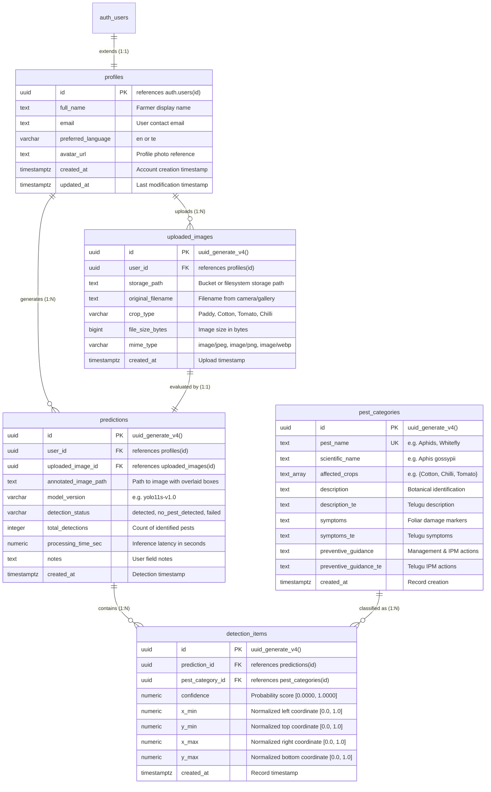

# CropGuard AI — Database Design & Schema Specification

**Project:** CropGuard AI — Intelligent Pest Detection & Crop Protection  
**Target RDBMS:** Supabase PostgreSQL (Managed Relational Cloud)  
**Security Model:** Row Level Security (RLS) with Multi-Tenant User Isolation  
**Academic Level:** B.Tech Computer Science & Engineering Final Project  

---

## 1. Overview & Architectural Principles

The database tier for CropGuard AI is architected on PostgreSQL provided by the user's existing Supabase instance (`https://cxzayeoqbocryekkqiyk.supabase.co`). The database serves as the source of truth for:
* User profiles and regional preferences (English vs Telugu).
* Master pest taxonomy, symptoms, and bilingual agricultural advisories.
* Metadata for crop images uploaded from mobile devices.
* Inference run outcomes (detection latency, confidence, pest bounding-box annotations).

### Key Architectural Principles:
1. **Relational Integrity:** Foreign keys enforce strict referential constraints with cascading updates and deletions.
2. **Normalized Coordinates:** Bounding boxes are stored as normalized floating-point ratios ($[0.0, 1.0]$), guaranteeing resolution independence across diverse smartphone screen form factors.
3. **Bilingual Schema Support:** Content columns are mirrored with Telugu suffixes (`_te`) to facilitate native language delivery without runtime translation latency.
4. **Zero-Trust Security via RLS:** Every table enforces PostgreSQL Row Level Security (RLS) preventing any farmer from accessing another farmer's scan records.

---

## 2. Entity-Relationship Diagram (ERD)

---

## 3. Data Dictionary & Table Specifications

### 3.1 `profiles` Table
Stores extended farmer metadata mapped directly to Supabase `auth.users`.

| Column | Type | Constraints | Default | Description |
|---|---|---|---|---|
| `id` | `UUID` | Primary Key, FK `auth.users(id)` ON DELETE CASCADE | — | Unique user identifier matching authentication session |
| `full_name` | `TEXT` | Nullable | `NULL` | Farmer's display name |
| `email` | `TEXT` | Nullable | `NULL` | Farmer's login email address |
| `preferred_language` | `VARCHAR(5)` | CHECK (`'en'`, `'te'`) | `'en'` | Active language preference for UI and advisory content |
| `avatar_url` | `TEXT` | Nullable | `NULL` | Public storage URL for farmer avatar |
| `created_at` | `TIMESTAMPTZ` | NOT NULL | `NOW()` | Timestamp when profile was initialized |
| `updated_at` | `TIMESTAMPTZ` | NOT NULL | `NOW()` | Timestamp when profile was last edited |

*Trigger:* `on_auth_user_created` automatically inserts a corresponding profile row upon sign-up in `auth.users`.

---

### 3.2 `pest_categories` Table
Catalog of harmful agricultural pests, botanical scientific descriptions, and bilingual control guidance.

| Column | Type | Constraints | Default | Description |
|---|---|---|---|---|
| `id` | `UUID` | Primary Key | `uuid_generate_v4()` | Unique pest category identifier |
| `pest_name` | `TEXT` | NOT NULL, UNIQUE | — | Standard common English name (e.g., *Aphids*) |
| `scientific_name` | `TEXT` | NOT NULL | — | Binomial taxonomic name (e.g., *Aphis gossypii*) |
| `affected_crops` | `TEXT[]` | NOT NULL | `'{}'` | Array of crops susceptible to this pest |
| `description` | `TEXT` | NOT NULL | — | Morphological and behavioral insect description |
| `description_te` | `TEXT` | Nullable | `NULL` | Telugu morphological description |
| `symptoms` | `TEXT` | NOT NULL | — | Observable plant stress and foliage damage markers |
| `symptoms_te` | `TEXT` | Nullable | `NULL` | Telugu crop damage symptoms |
| `preventive_guidance` | `TEXT` | NOT NULL | — | Integrated Pest Management (cultural, chemical, biological) |
| `preventive_guidance_te`| `TEXT` | Nullable | `NULL` | Telugu IPM recommendations |
| `created_at` | `TIMESTAMPTZ` | NOT NULL | `NOW()` | Registration timestamp |

---

### 3.3 `uploaded_images` Table
Maintains audit trail of all foliage images submitted for analysis.

| Column | Type | Constraints | Default | Description |
|---|---|---|---|---|
| `id` | `UUID` | Primary Key | `uuid_generate_v4()` | Unique upload identifier |
| `user_id` | `UUID` | NOT NULL, FK `profiles(id)` ON DELETE CASCADE | — | Authenticated user who submitted the image |
| `storage_path` | `TEXT` | NOT NULL | — | Relative or absolute path in cloud storage bucket |
| `original_filename` | `TEXT` | NOT NULL | — | Original client file name |
| `crop_type` | `VARCHAR(50)` | NOT NULL | `'Other'` | Host crop context (*Paddy/Rice, Cotton, Tomato, Chilli*) |
| `file_size_bytes` | `BIGINT` | Nullable | `NULL` | Exact image payload size in bytes |
| `mime_type` | `VARCHAR(50)` | Nullable | `'image/jpeg'` | Verified MIME type |
| `created_at` | `TIMESTAMPTZ` | NOT NULL | `NOW()` | Upload timestamp |

---

### 3.4 `predictions` Table
High-level summary of model inference runs.

| Column | Type | Constraints | Default | Description |
|---|---|---|---|---|
| `id` | `UUID` | Primary Key | `uuid_generate_v4()` | Unique prediction event identifier |
| `user_id` | `UUID` | NOT NULL, FK `profiles(id)` ON DELETE CASCADE | — | Authenticated user owner |
| `uploaded_image_id` | `UUID` | NOT NULL, FK `uploaded_images(id)` ON DELETE CASCADE | — | Analyzed source image |
| `annotated_image_path` | `TEXT` | Nullable | `NULL` | Path to image with rendered bounding boxes |
| `model_version` | `VARCHAR(50)` | NOT NULL | `'yolo11s-v1.0'` | Model weight checkpoint used for inference |
| `detection_status` | `VARCHAR(30)` | CHECK (`'detected'`, `'no_pest_detected'`, `'failed'`, `'pending'`) | `'pending'` | Outcome state |
| `total_detections` | `INTEGER` | NOT NULL | `0` | Total bounding boxes detected |
| `processing_time_sec` | `NUMERIC(6,3)`| Nullable | `NULL` | Inference pipeline latency in seconds |
| `notes` | `TEXT` | Nullable | `NULL` | Farmer field observation notes |
| `created_at` | `TIMESTAMPTZ` | NOT NULL | `NOW()` | Timestamp of inference execution |

---

### 3.5 `detection_items` Table
Atomic bounding-box coordinates and confidence scores for each individual insect detected in an image.

| Column | Type | Constraints | Default | Description |
|---|---|---|---|---|
| `id` | `UUID` | Primary Key | `uuid_generate_v4()` | Unique detection item identifier |
| `prediction_id` | `UUID` | NOT NULL, FK `predictions(id)` ON DELETE CASCADE | — | Parent prediction run |
| `pest_category_id` | `UUID` | FK `pest_categories(id)` ON DELETE SET NULL | `NULL` | Associated insect category |
| `confidence` | `NUMERIC(5,4)`| CHECK (`0.0 <= confidence <= 1.0`) | — | Prediction confidence score |
| `x_min` | `NUMERIC(7,4)`| NOT NULL | — | Normalized left bounding coordinate $[0.0, 1.0]$ |
| `y_min` | `NUMERIC(7,4)`| NOT NULL | — | Normalized top bounding coordinate $[0.0, 1.0]$ |
| `x_max` | `NUMERIC(7,4)`| NOT NULL | — | Normalized right bounding coordinate $[0.0, 1.0]$ |
| `y_max` | `NUMERIC(7,4)`| NOT NULL | — | Normalized bottom bounding coordinate $[0.0, 1.0]$ |
| `created_at` | `TIMESTAMPTZ` | NOT NULL | `NOW()` | Detection item timestamp |

---

## 4. Row Level Security (RLS) Policy Matrix

| Table | Operation | Target Role | Policy Definition (`USING` / `WITH CHECK`) | Purpose |
|---|---|---|---|---|
| `profiles` | `SELECT` | `authenticated` | `auth.uid() = id` | Farmers can only read their own profile |
| `profiles` | `UPDATE` | `authenticated` | `auth.uid() = id` | Farmers can only edit their own profile |
| `pest_categories` | `SELECT` | `public`, `anon`, `authenticated` | `true` | Pest advisories are globally readable by all users |
| `uploaded_images` | `SELECT` | `authenticated` | `auth.uid() = user_id` | Prevents unauthorized viewing of other farms' crops |
| `uploaded_images` | `INSERT` | `authenticated` | `auth.uid() = user_id` | Farmers can only upload into their own account |
| `uploaded_images` | `DELETE` | `authenticated` | `auth.uid() = user_id` | Farmers can only delete their own images |
| `predictions` | `SELECT` | `authenticated` | `auth.uid() = user_id` | Strict tenant scan history isolation |
| `predictions` | `INSERT` | `authenticated` | `auth.uid() = user_id` | Prevents spoofing scan records for another user |
| `predictions` | `DELETE` | `authenticated` | `auth.uid() = user_id` | Farmers can delete their own scan history |
| `detection_items` | `SELECT` | `authenticated` | `EXISTS (SELECT 1 FROM predictions p WHERE p.id = prediction_id AND p.user_id = auth.uid())` | Box coordinates are only accessible to the scan owner |

---

## 5. Performance Indexing Strategy

To maintain sub-10ms response times for mobile history feeds:
1. `idx_profiles_email`: Accelerates lookup during login/profile sync (`profiles.email`).
2. `idx_pest_categories_name`: Accelerates pest resolution by taxonomy name (`pest_categories.pest_name`).
3. `idx_uploaded_images_user`: Fast lookups for all images uploaded by a farmer (`uploaded_images.user_id`).
4. `idx_predictions_user`: Powers the main mobile History Dashboard screen (`predictions.user_id, created_at DESC`).
5. `idx_detection_items_prediction`: Accelerates joining bounding boxes when loading scan details (`detection_items.prediction_id`).
